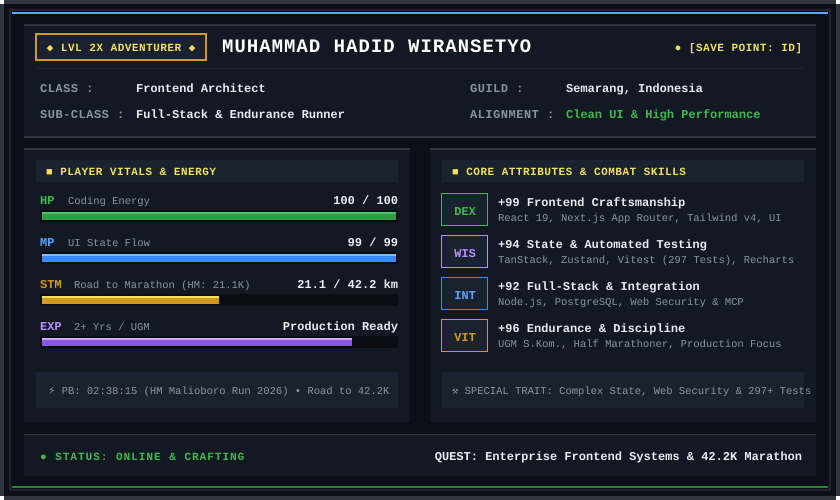

<div align="center">

<!-- RETRO TYPING BANNER -->
<a href="https://github.com/hadidwirsty">
  
</a>

<br/><br/>

<!-- 16-BIT RETRO RPG CHARACTER STATUS CARD -->


<br/><br/>

<!-- PIXEL ART DIVIDER -->


</div>

<br/>

### 🎒 Inventory & Equipment Slots

```
[ INVENTORY SLOTS: EQUIPPED GEAR & ARTIFACTS ]
```

* **⚔️ Main Hand (Primary Weapon — Core Frontend Craft):**  
  
  
  
  -000000?style=for-the-badge&logo=next.js&logoColor=white)
  -38B2AC?style=for-the-badge&logo=tailwind-css&logoColor=white)
  

* **🪄 Spellbook (State Architecture & Data Visualization):**  
  
  
  
  
  
  

* **🧪 Battle Shields (Automated Testing & Web Security Hardening):**  
  
  
  
  
  
  

* **🛡️ Off Hand (Full-Stack Shield & Backend Integration):**  
  
  
  
  
  
  -8957E5?style=for-the-badge&logo=anthropic&logoColor=white)

* **📜 Supporting Grimoires (Enterprise Frameworks & Ecosystem):**  
  
  
  
  -512BD4?style=for-the-badge&logo=dotnet&logoColor=white)
  
  

<br/>

<div align="center">
  
</div>

<br/>

### 📜 Active Quests & Notable Campaigns

```
[ ACTIVE QUEST LOG: KEY EXPEDITIONS & REPOSITORIES ]
```

| Quest / Artifact | Focus | Highlights & Architecture | Status |
| :--- | :--- | :--- | :---: |
| 🚚 **[HW Trans Fleet (hiblow-fleet)](https://github.com/hadidwirsty/hiblow-fleet)** | Operational Logistics & Analytics | Sistem manajemen armada semen curah: omset ritase real-time, rasio BBM & operasional supir, margin PnL, **100% React Server Components (RSC)**, Server Actions, Drizzle ORM, dan **297 unit tests otomatis (Vitest, 100% pass)**. | `ACTIVE` |
| ⌚ **[garmin-connect-mcp](https://github.com/hadidwirsty/garmin-connect-mcp)** | AI MCP Server / Biometric Telemetry | Model Context Protocol server untuk Garmin Connect Personal API: analisis aktivitas lari, FIT telemetry streams, sleep hypnogram, overnight HRV, dan body battery (`TypeScript`, `MCP SDK`). | `COMPLETED` |
| 🛡️ **[intervals-icu-mcp](https://github.com/hadidwirsty/intervals-icu-mcp)** | AI MCP Server / Endurance Analytics | Integrasi server *Model Context Protocol* menghubungkan agen AI dengan platform analitik ketahanan **Intervals.icu** untuk evaluasi fisiologis atlet lari secara real-time (`TypeScript`, `MCP SDK`). | `COMPLETED` |
| 🏢 **[Enterprise Productions (Telkomsigma & Telkom)](https://hadidwirsty.vercel.app)** | National & Corporate Systems | Membangun UI untuk institusi nasional: **BPJS Kesehatan (IMAPS)**, **Telkom Indonesia (Netmonk Analytics)**, **WBS Internal** (magic bytes binary validation), **Alisa 2.0** (Module Federation Micro-Frontend), dan PoC **IS-WARE** (#1 evaluasi teknis tender). | `CONQUERED` |

<br/>

<div align="center">
  
</div>

<br/>

### ⚔️ Adventurer's Battle Records

<div align="center">
  <a href="https://github.com/hadidwirsty">
    
  </a>
  <a href="https://github.com/hadidwirsty">
    
  </a>
  <br/><br/>
  <a href="https://github.com/hadidwirsty">
    
  </a>
</div>

<br/>

<div align="center">
  
</div>

<br/>

### 🍻 Tavern & Guild Hall

```
[ REST AREA: LET'S PARTY UP & BUILD SOMETHING GREAT ]
```

* 📍 **Base Camp:** Semarang &amp; Yogyakarta, Indonesia
* 🎓 **Almamater:** Universitas Gadjah Mada (UGM) — Bachelor of Computer Science (S.Kom.)
* 📜 **Official Guild Certifications:**
  * **React Web Developer Expert** — Dicoding Indonesia (Valid to Oct 2027)
  * **Cloud Practitioner Essentials (AWS)** — Dicoding Indonesia
  * **Agile Foundations** — LinkedIn Learning
* 🌐 **Online Grimoire / Portfolio:** [hadidwirsty.vercel.app](https://hadidwirsty.vercel.app)
* 💼 **Guild Network:** [linkedin.com/in/hadidwirsty](https://linkedin.com/in/hadidwirsty)
* 🏃 **Athletic Discipline:** Road Marathoner &amp; Endurance Enthusiast
* 💬 **Quest Inquiries:** Terbuka untuk diskusi arsitektur *Frontend Engineering*, *Design Systems*, *Test-Driven Development (TDD)*, dan integrasi AI tooling (MCP).

<br/>

<div align="center">
  <a href="https://linkedin.com/in/hadidwirsty">
    
  </a>
</div>

<br/>
