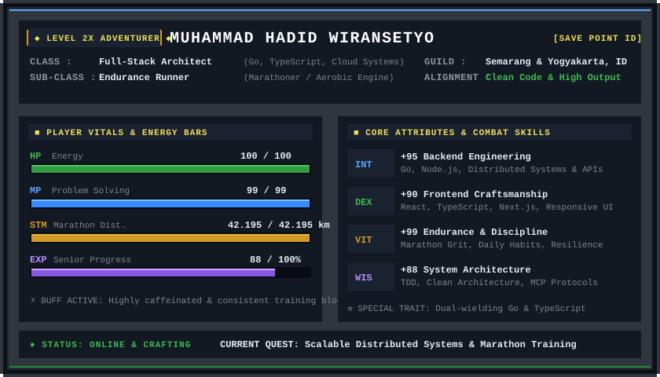

<div align="center">

<!-- RETRO TYPING BANNER -->
<a href="https://github.com/hadidwirsty">
  
</a>

<br/><br/>

<!-- 16-BIT RETRO RPG CHARACTER STATUS CARD -->


<br/><br/>

<!-- PIXEL ART DIVIDER -->


</div>

<br/>

### 🎒 Inventory & Equipment Slots

```
[ INVENTORY SLOTS: EQUIPPED GEAR & ARTIFACTS ]
```

* **⚔️ Main Hand (Primary Weapon — Core Frontend Craft):**  
  
  
  
  -000000?style=for-the-badge&logo=next.js&logoColor=white)
  -38B2AC?style=for-the-badge&logo=tailwind-css&logoColor=white)
  

* **🪄 Spellbook (State Management & Data Visualization):**  
  
  
  
  
  
  

* **🛡️ Off Hand (Full-Stack Shield & Backend Integration):**  
  -00ADD8?style=for-the-badge&logo=go&logoColor=white)
  
  
  
  
  

* **📜 Supporting Grimoires (Enterprise Frameworks & Ecosystem):**  
  
  
  
  -512BD4?style=for-the-badge&logo=dotnet&logoColor=white)
  
  

<br/>

<div align="center">
  
</div>

<br/>

### 📜 Active Quests & Notable Campaigns

```
[ ACTIVE QUEST LOG: KEY EXPEDITIONS & REPOSITORIES ]
```

| Quest / Artifact | Focus | Highlights & Architecture | Status |
| :--- | :--- | :--- | :---: |
| 🚚 **[HW Trans Fleet (hiblow-fleet)](https://github.com/hadidwirsty/hiblow-fleet)** | Operational Logistics & Analytics | Mendigitalisasi logistik armada semen curah: omset ritase real-time, rasio BBM & operasional supir, margin PnL, serta grafik Recharts interaktif (`Next.js App Router`, `RSC`, `Tailwind v4`, `shadcn/ui`, `Zustand`). | `ACTIVE` |
| 🛒 **[Momiji Home](https://github.com/Tumbuhin-Digital/momiji-home-frontend)** | B2B US Wholesale & Supply Chain | Arsitektur storefront modern (`Next.js 16`, `React 19`, `Tailwind v4`). Concurrency mutex token JWT via **Web Locks API**, multi-warehouse shipping split, dan Domain Adapter Pattern untuk DTO backend Go. | `DEPLOYED` |
| 🛡️ **[intervals-icu-mcp](https://github.com/hadidwirsty/intervals-icu-mcp)** | AI MCP Server / Endurance Analytics | Integrasi server *Model Context Protocol* menghubungkan AI dengan platform analitik ketahanan **Intervals.icu** untuk evaluasi fisiologis atlet lari secara real-time (`TypeScript`, `MCP SDK`). | `COMPLETED` |
| 🏢 **[Enterprise Productions (Telkomsigma & Telkom)](https://hadidwirsty.vercel.app)** | National & Corporate Systems | Membangun UI untuk institusi nasional: **BPJS Kesehatan (IMAPS)**, **Telkom Indonesia (Netmonk Analytics)**, dasbor insiden MONARA, dan PoC IS-WARE (peringkat #1 evaluasi teknis tender). | `CONQUERED` |

<br/>

<div align="center">
  
</div>

<br/>

### ⚔️ Adventurer's Battle Records

<div align="center">
  <a href="https://github.com/hadidwirsty">
    
  </a>
  <a href="https://github.com/hadidwirsty">
    
  </a>
  <br/><br/>
  <a href="https://github.com/hadidwirsty">
    
  </a>
</div>

<br/>

<div align="center">
  
</div>

<br/>

### 🍻 Tavern & Guild Hall

```
[ REST AREA: LET'S PARTY UP & BUILD SOMETHING GREAT ]
```

* 📍 **Base Camp:** Semarang &amp; Yogyakarta, Indonesia
* 🎓 **Almamater:** Universitas Gadjah Mada (UGM) — Bachelor of Computer Science (S.Kom.)
* 🌐 **Online Grimoire / Portfolio:** [hadidwirsty.vercel.app](https://hadidwirsty.vercel.app)
* 💼 **Guild Network:** [linkedin.com/in/hadidwirsty](https://linkedin.com/in/hadidwirsty)
* 🏃 **Athletic Discipline:** Road Marathoner &amp; Endurance Enthusiast
* 💬 **Quest Inquiries:** Terbuka untuk diskusi arsitektur *Frontend Engineering*, *Design Systems*, integrasi API/MCP, dan teknologi berbasis web performa tinggi.

<br/>

<div align="center">
  <a href="https://linkedin.com/in/hadidwirsty">
    
  </a>
</div>

<br/>
